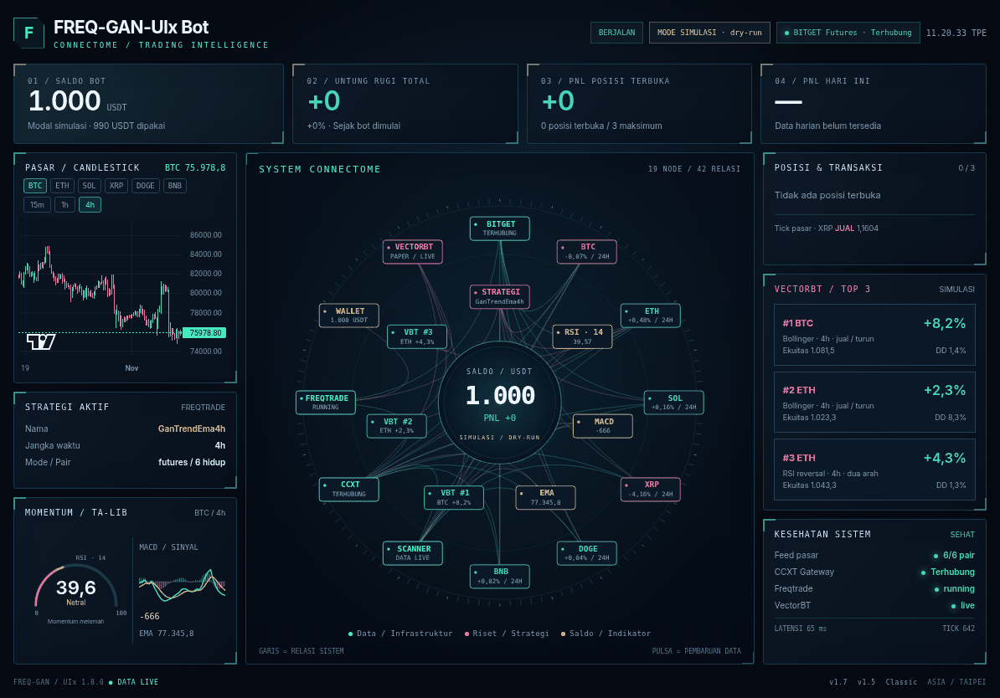
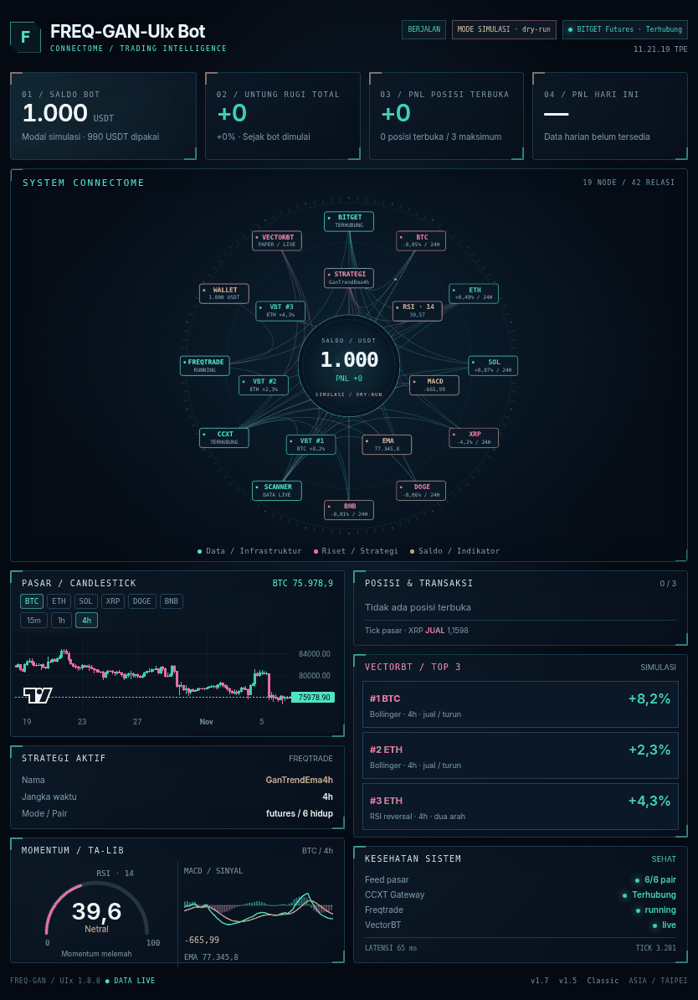
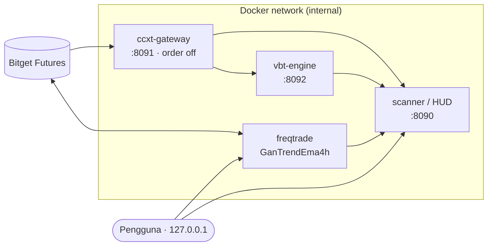

<div align="center">

# ⚡ FREQ-GAN

**Bot trading futures Bitget berbasis freqtrade — strategi GanTrendEma4h, scanner realtime, VectorBT, dan dashboard Sci-Fi HUD.**

[](#%EF%B8%8F-peringatan)
[](LICENSE)
[](https://github.com/freqtrade/freqtrade)
[](https://www.python.org/)
[](https://docs.docker.com/compose/)
[](https://www.bitget.com/)

[Fitur](#-fitur) •
[Arsitektur](#%EF%B8%8F-arsitektur) •
[Instalasi](#-instalasi) •
[Kontrol](#%EF%B8%8F-kontrol-satu-jalur-saklar) •
[Keamanan](#-keamanan) •
[Backtest](#-hasil-backtest) •
[Lisensi](#-lisensi)

<br>

<table>
<tr>
<td align="center"><br><sub>Landscape</sub></td>
<td align="center"><br><sub>Potret (iPad)</sub></td>
</tr>
</table>

<sub>Dashboard Sci-Fi HUD 1.8.0 — System Connectome &amp; panel telemetri (mode simulasi)</sub>

</div>

> [!NOTE]
> **Fork dari [freqtrade](https://github.com/freqtrade/freqtrade), dimodifikasi oleh ganezha sejak 2026.**

> [!WARNING]
> Proyek ini berjalan dalam mode **DRY-RUN** (simulasi, tanpa dana nyata). Trading futures dengan leverage berisiko sangat tinggi dan dapat menghabiskan modal. Gunakan dengan risiko Anda sendiri.

---

## 📑 Daftar Isi

- [Fitur](#-fitur)
- [Arsitektur](#%EF%B8%8F-arsitektur)
- [Instalasi](#-instalasi)
- [Kontrol (satu jalur saklar)](#%EF%B8%8F-kontrol-satu-jalur-saklar)
- [Ubah Konfigurasi Manual](#%EF%B8%8F-ubah-konfigurasi-manual)
- [Pasang API Key Manual](#-pasang-api-key-manual)
- [Menyalakan Bot Mode Live](#-menyalakan-bot-mode-live)
- [Keamanan](#-keamanan)
- [Hasil Backtest](#-hasil-backtest)
- [Kredit](#-kredit)
- [Lisensi](#-lisensi)

---

## ✨ Fitur

| Komponen | Keterangan |
|:--|:--|
| 🎯 **Strategi** | `GanTrendEma4h` — timeframe 4h, long + short, leverage 2x isolated |
| 🧪 **Strategy Lab** | 10 strategi futures diuji in-sample / out-of-sample (IS/OOS) |
| 📡 **Scanner** | Data pasar realtime Bitget USDT perpetuals via cryptofeed |
| 📈 **VectorBT** | Grid 21.168 kombinasi IS/OOS, top-3 berjalan sebagai paper account |
| 🛰️ **Dashboard** | Sci-Fi HUD 1.8.0 satu layar: System Connectome (19 node / 42 relasi), RSI &amp; MACD (TA-Lib), panel telemetri |

> Kode dashboard dikelola sebagai komponen terpisah (repositori privat).

---

## 🏗️ Arsitektur



| Layanan | Alamat | Fungsi |
|:--|:--|:--|
| `freqtrade` | `127.0.0.1:8080` | Bot trading + FreqUI |
| `freqgan-scanner` | `127.0.0.1:8090` | Scanner + dashboard Sci-Fi HUD |
| `freqgan-ccxt-gateway` | internal `8091` | Data exchange via ccxt (order dinonaktifkan) |
| `freqgan-vbt-engine` | internal `8092` | Mesin backtest VectorBT |

---

## 🚀 Instalasi

```bash
git clone https://github.com/ganezha/FREQ-GAN.git
cd FREQ-GAN
git checkout gan-stable

# Siapkan konfigurasi (panduan lengkap di config.example.md)
cp config.example.json user_data/config.json

# Jalankan layanan
docker compose up -d
```

> [!TIP]
> Isi rahasia (API key, password) hanya di file `.env`, jangan di `config.json` yang ter-commit.

---

## 🎛️ Kontrol (satu jalur saklar)

Semua layanan dikendalikan hanya lewat tiga perintah:

| Perintah | Fungsi |
|:--|:--|
| `~/bin/bot-on` | Menyalakan semua layanan (mode live wajib konfirmasi `LIVE`) |
| `~/bin/bot-off` | Mematikan semua layanan |
| `~/bin/bot-status` | Menampilkan status layanan |

---

## ⚙️ Ubah Konfigurasi Manual

Pengaturan utama bot ada di dua tempat:

| Pengaturan | File | Contoh nilai | Arti |
|:--|:--|:--|:--|
| `dry_run` | `user_data/config.json` | `true` / `false` | `true` = simulasi (uang virtual), `false` = **live, uang asli** |
| `stake_amount` | `user_data/config.json` | `10` | Modal (margin) per posisi, dalam USDT |
| `max_open_trades` | `user_data/config.json` | `1` | Jumlah posisi maksimal yang boleh terbuka bersamaan |
| `trading_mode` | `user_data/config.json` | `"futures"` | Jenis pasar |
| `margin_mode` | `user_data/config.json` | `"isolated"` | Rugi satu posisi tidak menyeret saldo lain |
| `LEVERAGE` | `user_data/strategies/GanBase.py` | `2.0` | Leverage untuk semua strategi GAN (dibatasi maksimal dari exchange) |

### Langkah demi langkah

**1. Matikan bot dulu**
```bash
~/bin/bot-off
```

**2. Backup file lama** (supaya bisa dikembalikan)
```bash
cd ~/FREQ-GAN
cp -p user_data/config.json user_data/config.json.bak-$(date +%Y%m%d-%H%M%S)
```

**3. Buka file dan ubah nilainya**
```bash
nano user_data/config.json
```
Cari baris yang ingin diubah, contoh:
```json
"max_open_trades": 1,
"stake_amount": 10,
"dry_run": false,
"trading_mode": "futures",
"margin_mode": "isolated",
```
Simpan dengan `Ctrl + O` lalu `Enter`, keluar dengan `Ctrl + X`.

> [!IMPORTANT]
> Angka ditulis **tanpa tanda kutip** (`10`), teks **dengan tanda kutip** (`"isolated"`), `true`/`false` **huruf kecil tanpa kutip**. Setiap baris diakhiri koma, kecuali baris terakhir di dalam kurung.

**4. Ubah leverage** (opsional)
```bash
nano user_data/strategies/GanBase.py
```
Ubah baris `LEVERAGE = 2.0` ke nilai yang diinginkan, lalu simpan.

**5. Cek file tidak rusak**
```bash
python3 -m json.tool user_data/config.json > /dev/null && echo "JSON OK"
```
Jika muncul error, perbaiki dulu (biasanya kurang koma atau tanda kutip).

**6. Nyalakan dan cek status**
```bash
~/bin/bot-on
~/bin/bot-status
```

> [!NOTE]
> Jika `dry_run` bernilai `false`, `bot-on` akan meminta **konfirmasi `LIVE`** sebelum menyala. Lihat [Menyalakan Bot Mode Live](#-menyalakan-bot-mode-live).

### Mengembalikan pengaturan lama
```bash
~/bin/bot-off
cp -p user_data/config.json.bak-YYYYMMDD-HHMMSS user_data/config.json
~/bin/bot-on
```

> [!CAUTION]
> Jangan pernah menulis API key, secret, atau passphrase di `config.json`. Simpan hanya di `.env` (`chmod 600`).

---

## 🔑 Pasang API Key Manual

Bot membaca API key dari **variabel lingkungan** (environment variable) di file `.env`, bukan dari `config.json`. File `.env` sudah masuk `.gitignore`, jadi tidak ikut ter-commit.

| Variabel | Isi | Dari Bitget |
|:--|:--|:--|
| `FREQTRADE__EXCHANGE__KEY` | API Key | Kunci API |
| `FREQTRADE__EXCHANGE__SECRET` | Secret Key | Kunci rahasia (hanya tampil sekali) |
| `FREQTRADE__EXCHANGE__PASSWORD` | Passphrase | Kata sandi yang Anda buat sendiri |

> [!WARNING]
> Buat API key Bitget dengan jenis **"dibuat oleh sistem" (HMAC)**, izin **Baca tulis** + **Perdagangan**, **tanpa izin Penarikan**, dan tautkan ke **IP server** Anda.

### Langkah demi langkah

**1. Matikan bot**
```bash
~/bin/bot-off
```

**2. Buat / buka file `.env`**
```bash
cd ~/FREQ-GAN
nano .env
```
Isi seperti ini (ganti teks setelah `=` dengan milik Anda, tanpa spasi dan tanpa tanda kutip):
```dotenv
FREQTRADE__EXCHANGE__KEY=isi_api_key_anda
FREQTRADE__EXCHANGE__SECRET=isi_secret_key_anda
FREQTRADE__EXCHANGE__PASSWORD=isi_passphrase_anda
```
Simpan dengan `Ctrl + O` lalu `Enter`, keluar dengan `Ctrl + X`.

**3. Kunci izin file** (hanya pemilik yang bisa membaca)
```bash
chmod 600 .env
ls -l .env     # harus terlihat: -rw-------
```

**4. Pastikan `docker-compose.yml` membaca `.env`**

Di bawah `services: → freqtrade:` harus ada baris:
```yaml
    env_file:
      - .env
```

**5. Cek variabel terbaca** (hanya menghitung, tidak menampilkan isi key)
```bash
grep -c '^FREQTRADE__EXCHANGE__' .env    # hasil harus 3
```

**6. Nyalakan dan cek status**
```bash
~/bin/bot-on
~/bin/bot-status
```
Jika key salah, log akan menampilkan error autentikasi (misalnya `Invalid API Key` / `passphrase`). Perbaiki isi `.env`, lalu ulangi dari langkah 1.

### Mengganti atau mencabut key
1. Hapus API key lama di halaman **Manajemen API** Bitget.
2. Buat key baru, lalu ulangi langkah 1–6 di atas.

> [!CAUTION]
> Jangan pernah mengirim API key, secret, atau passphrase lewat chat, email, screenshot, atau menaruhnya di `config.json` / README. Jika key bocor, **hapus segera** di Bitget.

---

## 🟢 Menyalakan Bot Mode Live

Saklar `~/bin/bot-on` punya **pengaman konfirmasi**, supaya bot **tidak pernah live tanpa sengaja**.

| Kondisi `dry_run` | Perilaku `bot-on` |
|:--|:--|
| `true` (simulasi) | Langsung menyala, tanpa pertanyaan |
| `false` (live) | Tampil peringatan + ringkasan, dicek syaratnya, lalu **wajib ketik `LIVE`** |

### Syarat sebelum live

Bot **dibatalkan otomatis** jika salah satu syarat ini belum terpenuhi:

| # | Syarat | Cara memenuhi |
|:--:|:--|:--|
| 1 | `config.json` valid (JSON benar) | Lihat [Ubah Konfigurasi Manual](#%EF%B8%8F-ubah-konfigurasi-manual) |
| 2 | API key lengkap di `.env` (KEY, SECRET, PASSWORD) | Lihat [Pasang API Key Manual](#-pasang-api-key-manual) |
| 3 | Izin `.env` = `600` | `chmod 600 ~/FREQ-GAN/.env` |
| 4 | `docker-compose.yml` memuat `env_file: .env` | Lihat langkah 4 di bagian API key |
| 5 | Dijalankan dari **terminal interaktif** | Login SSH biasa, bukan dari script / cron |

### Langkah demi langkah

**1. Pastikan bot mati**
```bash
~/bin/bot-off
~/bin/bot-status      # semua harus "mati"
```

**2. Cek ulang pengaturan**
```bash
cd ~/FREQ-GAN
grep -nE '"(dry_run|stake_amount|max_open_trades|trading_mode|margin_mode)"' user_data/config.json
grep -n "LEVERAGE =" user_data/strategies/GanBase.py
```
Pastikan `dry_run` bernilai `false` dan modal, jumlah posisi, serta leverage sesuai keinginan.

**3. Pastikan saldo Futures cukup**

Saldo USDT di akun **Futures** Bitget harus **lebih besar** dari `stake_amount` (contoh: di atas 10 USDT).

**4. Jalankan saklar**
```bash
~/bin/bot-on
```
Layar akan menampilkan ringkasan seperti ini:
```text
==================================================
  PERINGATAN: MODE LIVE - MEMAKAI UANG ASLI
==================================================
  Exchange        : bitget
  Mode            : futures / isolated
  Leverage        : 2.0x
  Modal per posisi: 10 USDT
  Posisi maksimal : 1
==================================================
Ketik LIVE (huruf besar) untuk menyalakan bot dengan uang asli:
```

**5. Konfirmasi**

| Anda mengetik | Hasil |
|:--|:--|
| `LIVE` (huruf besar semua) | ✅ Bot menyala **live** |
| Selain itu (`live`, `ya`, kosong, dll.) | ❌ Dibatalkan, bot tetap mati |

**6. Cek status**
```bash
~/bin/bot-status
```
Pastikan terlihat `Dry-run : False`, container `running`, dan `API ping : pong`.

**7. Pantau log**
```bash
docker logs -f --tail 50 freqtrade     # keluar: Ctrl + C (bot tetap jalan)
```
Strategi `GanTrendEma4h` memakai candle **4 jam**, jadi order pertama bisa baru muncul berjam-jam kemudian. Ini normal.

### Riwayat konfirmasi

Setiap konfirmasi `LIVE` tercatat otomatis:
```bash
cat ~/FREQ-GAN/user_data/logs/live-confirm.log
```
Contoh isi: `2026-11-07 06:15:12 LIVE dikonfirmasi oleh <user> stake=10 max=1 lev=2.0`

### Mematikan / kembali ke simulasi

```bash
~/bin/bot-off                                   # matikan bot
nano ~/FREQ-GAN/user_data/config.json           # ubah "dry_run": true
~/bin/bot-on                                    # menyala lagi sebagai simulasi
```

> [!WARNING]
> `bot-off` hanya mematikan bot. **Posisi yang sudah terbuka tetap ada di Bitget** sampai ditutup manual di aplikasi Bitget atau bot dinyalakan kembali.

---

## 🔐 Keamanan

- 🔑 Rahasia disimpan di `.env` dengan izin `chmod 600` dan **tidak pernah di-commit**.
- 🚫 API key exchange **tanpa izin withdraw** dan dibatasi **IP whitelist**.
- 🧱 Port hanya terikat ke `127.0.0.1` atau jaringan internal Docker.
- 🕵️ Setiap commit dipindai dengan [gitleaks](https://github.com/gitleaks/gitleaks).

---

## 📊 Hasil Backtest

| Periode | Rentang | Trade | Win rate | Profit |
|:--|:--|--:|--:|--:|
| In-sample | 2024-09-01 → 2026-08-01 | — | 83,5% | **+70,5%** |
| Out-of-sample | 2026-08 → 2026-11-06 | 20 | 75% | **+2,6%** |

> [!CAUTION]
> Hasil backtest masa lalu **tidak menjamin** hasil di masa depan. Bukan nasihat keuangan.

---

## 🙏 Kredit

Dibangun di atas **[freqtrade](https://github.com/freqtrade/freqtrade)** © tim dan kontributor freqtrade. README asli proyek tersimpan di riwayat repositori upstream.

## 📄 Lisensi

Didistribusikan di bawah **GNU General Public License v3.0**, sama dengan proyek asli. Lihat [LICENSE](LICENSE).

<div align="center"><sub>FREQ-GAN · dimodifikasi oleh ganezha · 2026</sub></div>
